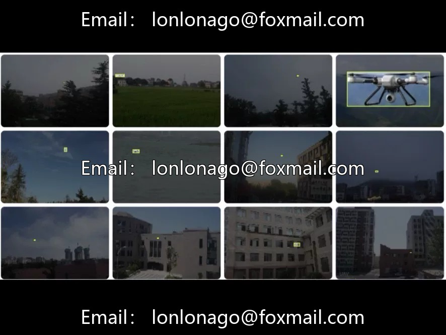
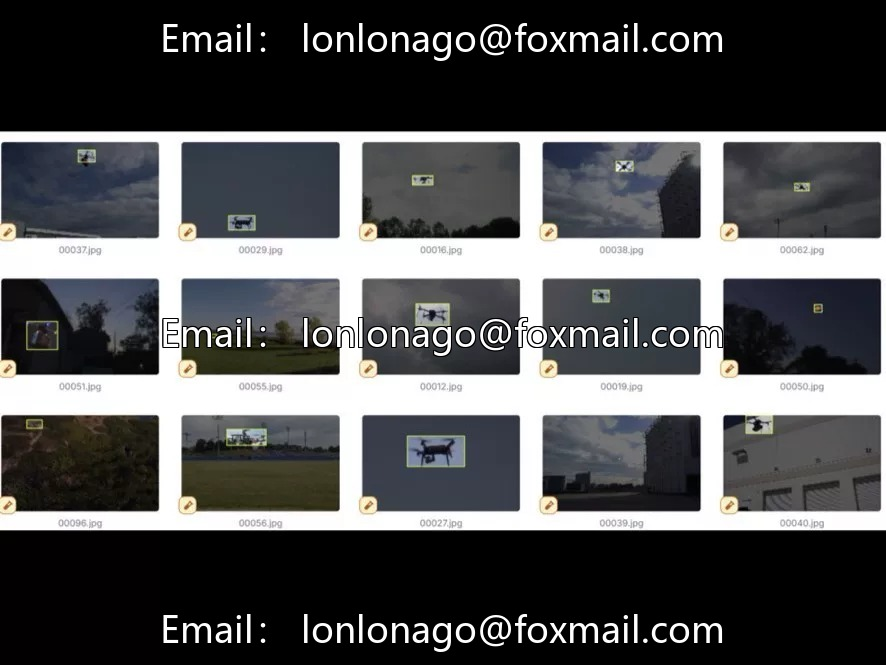
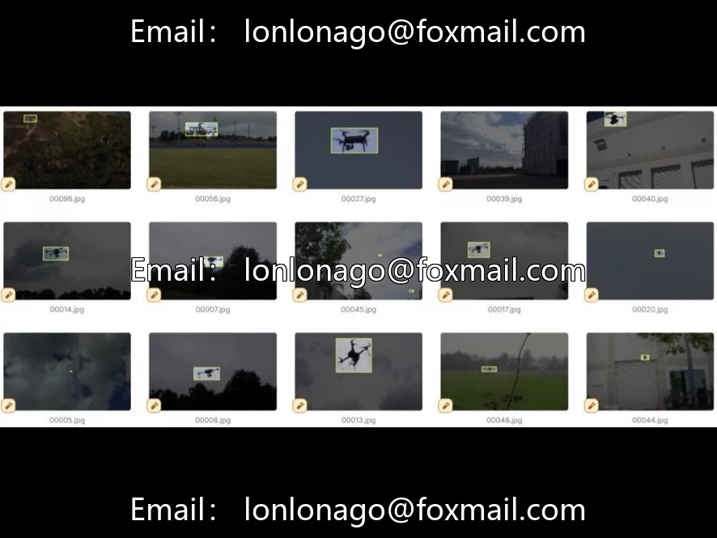

# Drone Detection and Tracking Dataset | Drone Detection Anti-Drone Low-Altitude Security YO

## Body

Drone Detection and Tracking Dataset | Drone Detection, Anti-Drone, Low-Altitude Security, YOLO format 9010th Issue

The dataset consists of 9500 drone detection images in YOLO format, single-category "Drone". It is large enough and focuses on low-altitude drone visual perception, serving for anti-drone, airspace safety, and aircraft regulation.

The core challenges of UAV vision inspection: UAVs are often small targets (low pixel ratio) in visual images and can easily be confused with aerial floating objects such as birds, kites, plastic bags. Additionally, their fast movement may result in motion blur during video detection. The large sample size of 9500 provides the model with learning different backgrounds, lighting, and distances for UAVs, thus handling complex scenarios.

Application Scenarios: Low-altitude security (airport, sports events, large-scale event intrusion warning), airspace supervision (urban low-altitude aircraft flow statistics and airway compliance monitoring), algorithm development (special benchmarks for small target detection, moving target tracking). Extendable for advanced tasks such as drone trajectory tracking, model classification, and flight intent prediction.

Technical suggestion: Utilizing multi-scale training, increasing the input resolution (e.g., 1280×1280), and introducing a high-low frequency feature fusion network can effectively enhance detection accuracy. When actual deployment is considered, it is necessary to take into account the limitations of edge computing power. Lightweight models and TensorRT acceleration are key to achieving success. A multimodal low-altitude fusion perception system can be constructed by combining radar or radio frequency spectrum data.

Applicable Directions: Anti-UAV Systems, Security Surveillance, Low-altitude Economic Regulation, Research and Development of UAV Tracking Algorithms. YOLO format directly connects to training.

Virtual materials, once sold, are non-refundable.
Interested friends, click "I want" to proceed.

## Images

## Payment

Here is a pay link on Stripe ( https://buy.stripe.com/3cs8yP7sY87d0vu9AB ). Please contact me lonlonago@foxmail.com after funding $89, and I will send you a complete data files , thank you!

